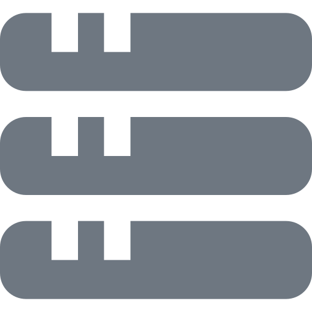
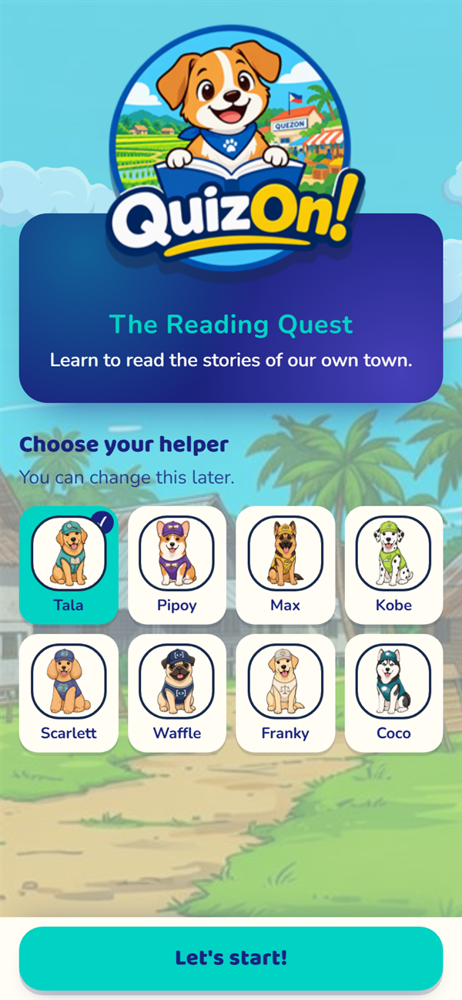
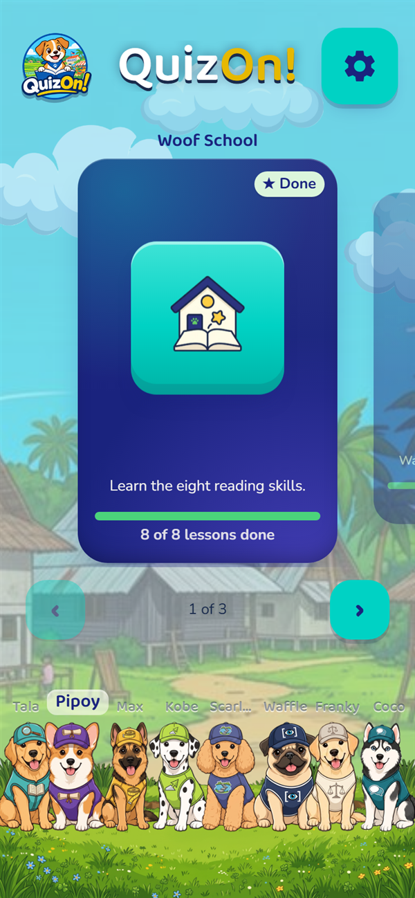
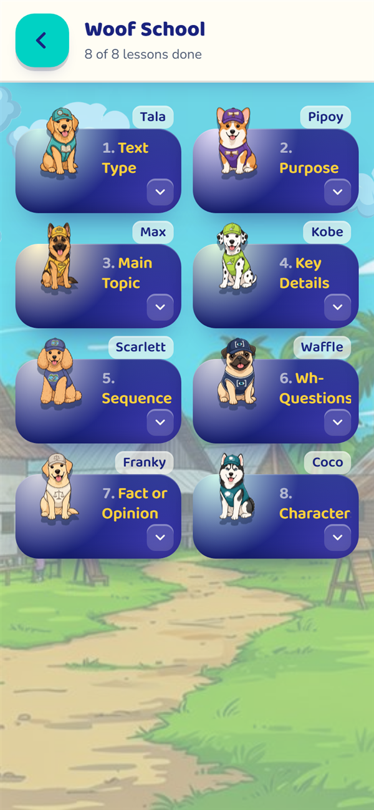
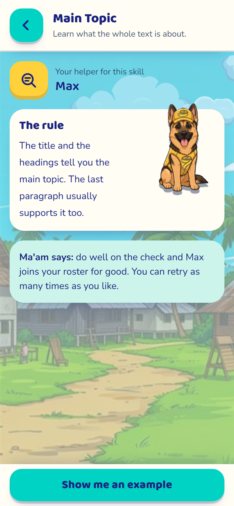
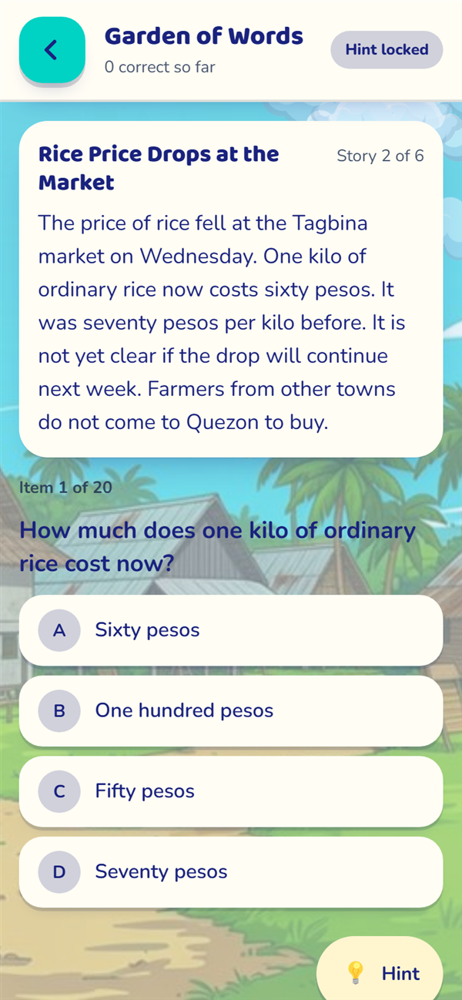
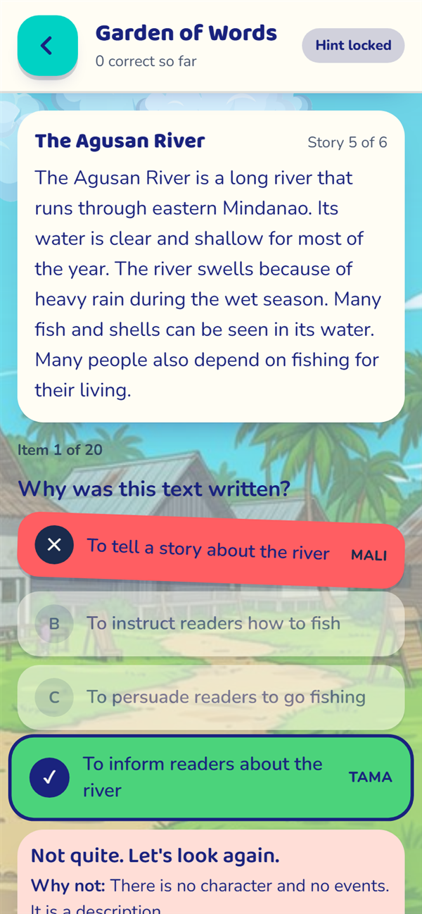
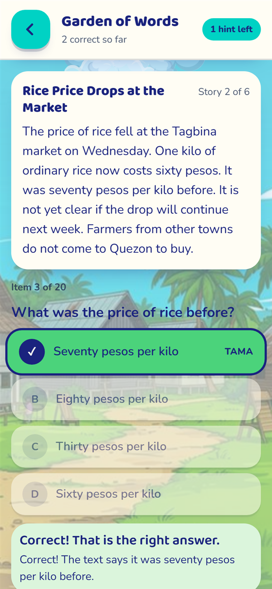
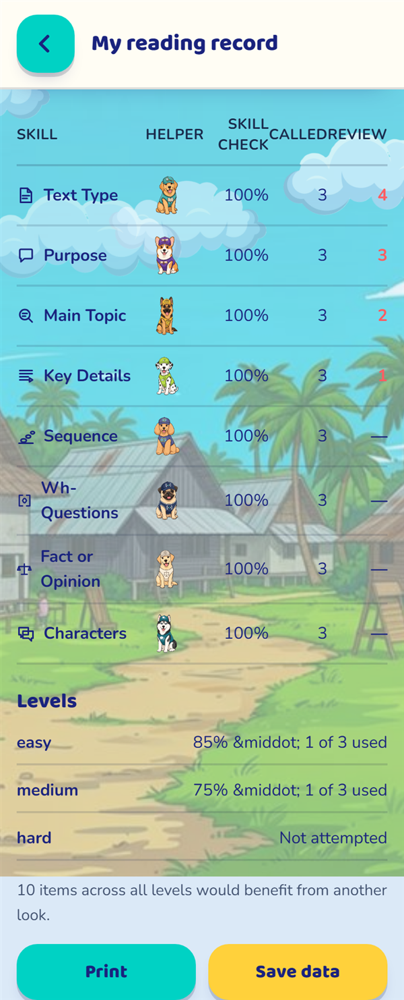

<!-- PROJECT LOGO -->
<br />
<div align="center">
  <a href="https://github.com/Marky012/quizon">
    
  </a>

  <h1 align="center">QuizOn! — The Quezon Challenge</h1>

  <p align="center">
    <strong>Offline-first gamified reading app for Grade 5 learners</strong>
    <br />
    Master the purpose and important details of informational texts — through stories from their own town.
    <br />
    <a href="#demo--screenshots"><strong>See the Screenshots »</strong></a>
    ·
    <a href="https://github.com/Marky012/quizon/issues">Report Bug</a>
    ·
    <a href="https://github.com/Marky012/quizon/issues">Request Feature</a>
  </p>

  <!-- BADGES -->
  <p>
    
    <!--  -->
    
    
    
    
    
  </p>
</div>

<br />

---

##  Table of Contents
- [ Overview](#overview)
- [ Features](#features)
- [ Demo & Screenshots](#demo--screenshots)
- [ Tech Stack](#tech-stack)
- [ Quick Start](#quick-start)
- [ Game Design & Pedagogy](#game-design--pedagogy)
- [ Architecture](#architecture)
- [ Accessibility](#accessibility)
- [ Offline & PWA](#offline--pwa)
- [ Testing & Quality Gates](#testing--quality-gates)
- [ Deployment](#deployment)
- [ Roadmap](#roadmap)
- [ Contributing](#contributing)

---

<a id="overview"></a>
##  Overview

**QuizOn!** is an offline-first, mobile-first gamified learning **Progressive Web App (PWA)** built for Grade 5 learners in Barangay Quezon, Tagbina, Surigao del Sur. It drills the DepEd English competency *"identifying the purpose and important details of informational texts (news, how-to, description, narrative)"* — using **six passages set in the learner's own town**, **eight guided lessons** taught by canine helper companions, and a **three-tier Reading Trail** assessment.

It runs **entirely in the browser**: no backend, no accounts, no tracking, and no student data leaving the device. Install it once and it keeps working on a phone with no signal — a hard requirement for a rural classroom where connectivity is intermittent at best.

The learner loop:

```
Boot → Welcome (choose a helper) → Profile (character + nickname) → Intro story
     → Hub (Stage Carousel + Pup Bench)
         ├── Woof School      → 8 skills, each taught by a pup → 5-item Pre-Test → 5/5 earns the pup
         ├── Reading Trail    → 3 tiers × 20 adaptive items → 70% to pass → Result
         └── Your Record      → mastery per skill, review list, printable report
```

---

<a id="features"></a>
##  Features

| Category | Highlights |
|----------|------------|
|  **Offline-First PWA** | ~10 MB precache, service worker with `autoUpdate`, deep links resolve offline. No network needed after the first load |
|  **Six Local Passages** | News, how-to, description and narrative set in Barangay Quezon and the Caraga region — *Heavy Rains over Agusan Island*, *Rice Price Drops at the Market*, *How to Plant Rice*, *How to Cook Tinolang Bahay*, *The Agusan River*, *A Night by the Shore* |
|  **The Woof Pack** | 8 reading skills, each taught by a pup whose name starts with the skill's initial — a memory hook, not decoration |
|  **Dual-Gate Assessment** | Pre-Test demands **5/5** to earn a helper (free retries). A Reading Trail tier demands **70% (14/20)**, capped at **3 attempts** so the teacher gets a "needs attention" flag instead of a silent failure |
|  **Adaptive Engine** | Miss-weighted question selection (up to **5×** weight on repeated misses) + Fisher-Yates option shuffling that removes positional bias |
|  **Three-Channel Feedback** | Color **+** icon badge **+** written word (*TAMA* / *MALI*). Color is never the only signal, so color-vision-deficient learners are not excluded |
|  **Progress & Reporting** | Mastery per skill, weakest-skill review list, printable one-page report card, and a JSON export of learner data |
|  **Keyboard & Screen Reader Ready** | Roving tabindex, `A–D` / `1–4` answer shortcuts, `radiogroup` roles with live `alert` / `status` regions, `prefers-reduced-motion` support |
|  **Zero Media Overhead** | No video, no audio files. Sound effects are synthesized with the Web Audio API, so the whole app stays under ~10 MB |

---

<a id="demo--screenshots"></a>
##  Demo & Screenshots

<p align="center">
  <em>Choose your helper — the first screen a learner ever sees</em><br/>
  
  <br/><br/>
  <em>The Hub — Stage Carousel and the Pup Bench</em><br/>
  
  <br/><br/>
  <em>Woof School — the eight skill modules</em><br/>
  
  <br/><br/>
  <em>A teaching screen — rule, real example, then the check</em><br/>
  
  <br/><br/>
  <em>Reading Trail — Garden of Words, 20 adaptive items on one assigned story</em><br/>
  
  <br/><br/>
  <em>Three-channel feedback — the wrong tap shows MALI, and reveals the correct answer</em><br/>
  
  <br/><br/>
  <em>Correct answer feedback</em><br/>
  
  <br/><br/>
  <em>Your Record — mastery per skill, and what to practise next</em><br/>
  
</p>

> Screenshots captured from the running app at `390 × 844` (iPhone-class viewport).

---

<a id="tech-stack"></a>
##  Tech Stack

###  Frontend
- **React 19** + **TypeScript 5.9** — strict types, no `any` in the content model
- **Vite 8** — dev server and bundler, one config for dev, build and PWA generation
- **Tailwind CSS v4** — utility styling on top of a custom CSS design-token layer
- **React Router 7** — browser router with a **lazy-loaded chunk per route**, each behind its own `Suspense` + error boundary
- **Zustand 5** — single persisted store, `useShallow` selectors

###  Content & Data
- **Zod 4** — runtime schemas for the skill manifest, question bank and tier definitions. Invalid content fails the build, not the classroom
- **400 authored questions** (148 core + 84 per tier pool), each distractor carrying a pedagogical `errorTag`
- **Fisher-Yates shuffle + miss-weighted adaptive selection** — the engine in `src/logic/select.ts`

###  PWA & Offline
- **vite-plugin-pwa 1.3** + **Workbox** — `generateSW`, `autoUpdate`, `navigateFallback: '/index.html'`
- Precaches **every** JS/CSS/HTML/SVG/PNG/JPG/WOFF2 chunk — 49 entries, ~10 MB
- **Web Audio API** oscillator synthesis for all sound effects — no audio files shipped

###  Dev Tools & Testing
- **Vitest 5** + **jsdom** — 251 automated tests across 12 suites
- **Type-check gate** — `npm run build` runs `tsc -b --noEmit` before bundling
- **Seeded PRNG** (Mulberry32) — reproducible shuffles and reproducible tests
- **Hidden dev menu** (`/dev`) — every route plus state presets, dropped from production builds by `import.meta.env.DEV`

---

<a id="quick-start"></a>
##  Quick Start

Requires **Node.js `^20.19.0 || >=22.12.0`** and npm. Nothing else — there is no backend to install.

```bash
# Clone the repository
git clone https://github.com/Marky012/quizon.git
cd quizon

# Install dependencies
npm install

# Start the dev server (LAN-reachable, so a real phone on the same wifi can load it)
npm run dev
# -> http://localhost:8080
```

| Script | What it does |
|--------|--------------|
| `npm run dev` | Vite dev server on `http://localhost:8080`, exposed on the local network |
| `npm run build` | Type-check (`tsc -b --noEmit`) then produce the production bundle in `dist/` with the service worker |
| `npm run preview` | Serve the production build locally on port 8080 |
| `npm test` | Run the full Vitest suite (12 files, 251 tests) |
| `npm run test:coverage` | Same suite with coverage reporting |
| `npm run lint` | ESLint (config pending — see [Roadmap](#roadmap)) |

> **Tip for testing on a phone:** `npm run dev` binds to the LAN. Open `http://<your-computer-ip>:8080` on any device on the same Wi-Fi to try the real touch layout.

---

<a id="game-design--pedagogy"></a>
##  Game Design & Pedagogy

### The 8 reading skills and their pups

Every skill is represented by a canine helper. **Each pup's name begins with the initial letter of the skill it teaches** — the mnemonic hook that makes the roster learnable for a Grade 5 reader.

| # | Skill | Helper | Breed | What the learner practises |
|---|-------|--------|-------|------------------------------|
| 1 | Text Type | **Ta**la | Shiba Inu | Recognising what kind of text is being read |
| 2 | Purpose | **Pi**poy | Basset Hound | Why the text was written |
| 3 | Main Topic | **Ma**x | Golden Retriever | What the whole text is about |
| 4 | Key Details | **Ko**be | English Pointer | Which sentences carry the important information |
| 5 | Sequence | **Sc**arlett | Rough Collie | Putting events in order |
| 6 | Wh-Questions | **Wa**ffle | Papillon | Finding the answer inside a question |
| 7 | Fact or Opinion | **Fr**anky | Pug | Separating verifiable facts from opinions |
| 8 | Characters | **Co**co | Philippine Aspin | Reading the voices of the people in a story |

`src/content/manifest.ts` is the **single source of truth**. Add or rename a skill there and the lessons, pre-tests, unlock gates, bench and record all follow — boot-time validation fails loudly on duplicate IDs, or if a pup's initial drifts from its skill's name.

### The dual gate

| Gate | Requirement | Attempts | Why |
|------|-------------|----------|-----|
| **Pre-Test** (Woof School) | **5 / 5** — perfection | Free, unlimited retries | Low stakes, concept-scoped. Perfection is achievable and fair for a Grade 5 pupil, and the reward is a lifelong companion |
| **Reading Trail tier** | **70%** (14 / 20) | Max **3** | Cumulative assessment across a whole story. Capped so a struggling learner is flagged for teacher intervention instead of grinding forever |

### Tunable rules

All of these live in `src/constants/gameConfig.ts` — one file, no magic numbers in components.

| Rule | Value |
|------|-------|
| `PASSING_SCORE` | `70` |
| `MAX_ATTEMPTS` | `3` |
| `PRETEST_QUESTION_COUNT` | `5` |
| `PRETEST_PASSING_SCORE` | `5` |
| `HINTS_PER_LEVEL` | `1` (locked until the first correct answer) |
| `ANSWER_FEEDBACK_DELAY` | `2000 ms` — long enough to read the pedagogical feedback |
| `QUESTION_HISTORY_LIMIT` | `200` — ring buffer for the adaptive engine |

### Feedback that teaches

When a pupil taps an option, three channels fire at once — colour, icon badge, and a written word — so the message survives colour blindness, glare and low-end screens. On a wrong tap the app does **not** just mark the answer: it shows the specific `errorTag` written for that distractor, and simultaneously reveals the correct answer.

---

<a id="architecture"></a>
##  Architecture

### Routing

The app is a spine with drill-downs off it. **Boot is the only redirector**, so a returning learner always lands in exactly one place.

```
/  ->  Boot decides  ->  /welcome  ->  /profile  ->  /intro  ->  /hub
                                                             |
                        +--------------+-------------+------+----------------+
                        |              |             |                      |
                    /skills        /pups         /arena                 /record
                        |              |             |
                   /skill/:id   /pretest/:id   /quiz/:level
                                       |             |
                                       +----> /result/:level
```

Every screen self-guards its own params: `Quiz` and `Result` render *"no result for that level yet"* for a bad `:level`, and the skill screens render *"that lesson does not exist"* for a bad `:id`. A child who taps a stale link is **told what happened**, not silently redirected. Legacy paths (`/challenges`, `/bantayan`, `/progress`) still redirect to their new homes.

### State

A single **Zustand** store persisted to `localStorage` under `quizon-game-storage`:

- Learner identity, player character and nickname (max 12 chars)
- Per-skill progress: lesson complete, pup earned, pup uses, best pre-test score
- Per-tier state: assigned story, attempt history, best score, hint usage, `needsAttention`
- **Active attempts** so a mid-quiz session resumes exactly where it stopped
- **Atomic writes** — an answer is persisted the moment it is tapped, so closing the browser during the 2-second feedback delay never loses it

### Content pipeline

```
src/content/manifest.ts   → skills, pups, symbols            (single source of truth)
src/content/texts.ts      → the 6 passages (T1–T6)
src/content/schemas.ts    → Zod schemas for every question
src/content/questions.ts  → 148 core questions + 5 pre-test items per skill
src/content/questions{Easy,Medium,Hard}.ts → 84 questions per tier pool
src/logic/select.ts       → shuffle + remap correctIndex + miss-weighted picking
```

Integrity is enforced by tests: every `skillTested` must match a manifest skill name, every `passageId` must resolve, every distractor must carry an `errorTag`, and every skill must have exactly 5 pre-test items.

### Project layout

```
quizon/
├── index.html              # HTML entry, PWA meta, font preloads
├── vite.config.ts          # Vite 8 + Tailwind 4 + PWA manifest + @ alias
├── src/
│   ├── screens/            # 14 screens, one lazy chunk each
│   ├── components/         # reusable UI (ScreenFrame, OptionButton, QuestionCard…)
│   ├── content/            # the manifest, passages, question bank, Zod schemas
│   ├── logic/              # attempt state machine, scoring, adaptive selection
│   ├── store/              # the persisted Zustand store
│   ├── lib/                # audio synthesis, back navigation, seeded random
│   └── dev/                # /dev route index + state presets (DEV only)
├── images/                 # README icons and screenshots
└── public/assets/          # app art: brand, pups, world, levels
```

---

<a id="accessibility"></a>
##  Accessibility

Built to be usable by the whole class, not just the fast readers.

- **Never colour alone** — every option state carries a colour, an icon badge (`✓` / `✕` / letter) *and* a written word (*TAMA* / *MALI*)
- **Roving tabindex** — arrow keys move between options; one tab stop per question
- **Direct keyboard answering** — press `1`–`4` or `A`–`D` to answer immediately
- **Screen reader support** — `role="radiogroup"` / `role="radio"` with live `aria-checked`; wrong answers announce through an assertive `role="alert"` so the teaching tag is read out, right answers through a polite `role="status"`
- **Reduced motion** — `prefers-reduced-motion` disables bounces, pulses and shakes, including the confetti burst
- **Touch ergonomics** — 14 px minimum type, 48–56 px minimum touch targets, 16 px minimum text spacing
- **Focus management** — on every navigation, focus moves to the new screen's heading, so a screen reader reads the new screen instead of continuing from a link that no longer exists

---

<a id="offline--pwa"></a>
##  Offline & PWA

| Property | Value |
|----------|-------|
| Strategy | `generateSW` via `vite-plugin-pwa`, `registerType: 'autoUpdate'` |
| Precache | **49 entries, ~10 MB** (`**/*.{js,css,html,svg,png,jpg,jpeg,webp,woff2,ico}`) |
| Navigation fallback | `/index.html` — deep links resolve with no network |
| Runtime cache | `NetworkFirst` for documents, `CacheFirst` for fonts |
| Stale cache | `cleanupOutdatedCaches: true` |
| Data | `localStorage` only — no server, no sync, no accounts |

The precache budget matters: the reference app this project was modelled on shipped **142 MB** of lesson video. Replacing that with text rules, real examples and synthesized Web Audio effects brought the whole app to **~10 MB**, so a cheap Android phone precaches in seconds on school Wi-Fi.

---

<a id="testing--quality-gates"></a>
##  Testing & Quality Gates

**251 automated tests across 12 suites**, run with `npm test`.

| Suite | Covers |
|-------|--------|
| `QuestionCard.test.tsx` | Correct and incorrect feedback states, all 8 pre-test items |
| `content.test.ts` | Schemas, option counts, required `errorTag`s, 5 pre-test items per skill |
| `references.test.ts` | `skillTested` join keys and `passageId` resolution |
| `scoring.test.ts` | The 70% threshold, attempt counters, review recommendations |
| `select.test.ts` | Fisher-Yates shuffling, correct-index remapping, adaptive weighting |
| `attempt.test.ts` | Attempt resumption, atomic answer persistence, state transitions |
| `gameStore.test.ts` | Hint locks, tier gates, pup rewards |
| `routeFallback.test.tsx` | Per-route fallbacks, header parity, bad-parameter guards |
| `onboardingGates.test.tsx` | The first-run spine and its one-way doors |
| `appBack.test.tsx` | Hierarchical back navigation across deep-linked routes |
| `pupBench.test.tsx` | Greyscale for unearned pups, live updates |
| `ConfettiBurst.test.tsx` | Confetti rendering and reduced-motion suppression |

```bash
# The full quality gate
npm test && npm run build
```

Both exit `0` with zero warnings.

---

<a id="deployment"></a>
##  Deployment

QuizOn! is a **fully static SPA** — any static host works: Vercel, Netlify, Render, GitHub Pages, or a school intranet machine.

```bash
npm run build      # -> dist/
```

**One required rule:** the host must rewrite all unknown paths to `/index.html`, because the router uses clean URLs (`/hub`, `/quiz/easy`, `/skill/main-topic`). Without that rewrite, a deep link 404s.

```json
// vercel.json
{ "rewrites": [{ "source": "/(.*)", "destination": "/index.html" }] }
```

---

<a id="roadmap"></a>
##  Roadmap

- [ ] Ship the PWA install icons the manifest already points at (`icon-192.png`, `icon-512.png`, `icon-maskable-512.png`) so the app installs with a proper home-screen icon
- [ ] Add ESLint + Prettier configuration — the `lint` script is declared, the dependency is not installed yet
- [ ] Teacher-facing roster view and CSV export, for classrooms that want to see more than one learner
- [ ] More local passages, and a Filipino (Tagalog) narration layer for the passages and feedback
- [ ] Text-to-speech read-aloud for passages, so pre-readers and screen-reader users get the same content
- [ ] Optional teacher sync for classrooms that regain connectivity between sessions

---

<a id="contributing"></a>
##  Contributing

Issues and pull requests are welcome. The project is a school prototype, so a few ground rules keep it coherent:

1. **Content changes go through `src/content/manifest.ts` and the question files only.** Never hard-code a skill, pup or tier name in a component.
2. **Every distractor needs an `errorTag`.** A wrong answer that only says "wrong" teaches nothing.
3. **Run the gate before you push:** `npm test && npm run build`.
4. **Keep the app offline-capable.** No new runtime dependency may require the network.
5. **Keep it small.** A child on a low-end phone is the user, not a desktop.

```bash
git clone https://github.com/Marky012/quizon.git
cd quizon
npm install
npm run dev
```

---

##  Acknowledgements

- **DepEd English competency** — *Identifying the purpose and important details of informational texts (news, how-to, description, narrative)*, Grade 5
- **Teacher Reyes** — the virtual classroom teacher in the app. She encourages, explains the rules and congratulates the learner, but never interrupts a quiz
- The learners, teachers and parents of Barangay Quezon, Tagbina, whose classroom conditions shaped every technical decision in this README

---

<div align="center">
  <sub>Built with React, Vite, TypeScript and Tailwind CSS · Runs entirely on the learner's device</sub>
</div>
